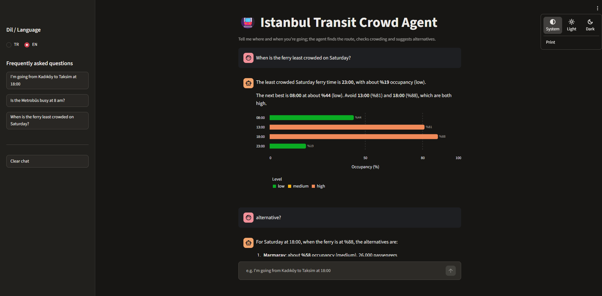
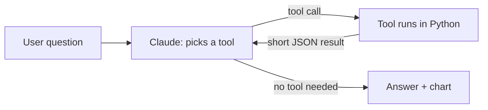
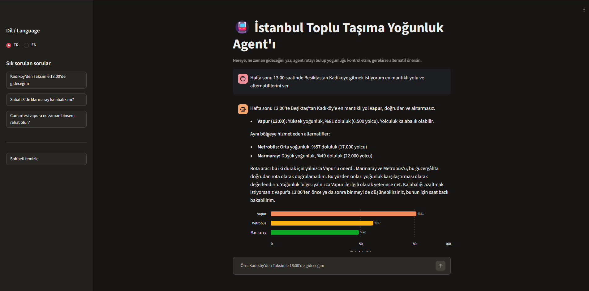
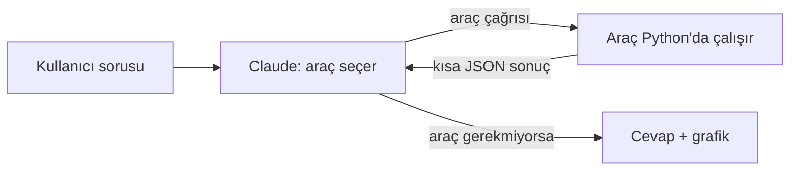

# 🚇 Istanbul Transit Crowd Agent / İstanbul Toplu Taşıma Yoğunluk Agent'ı


[🇬🇧 English](#-english) · [🇹🇷 Türkçe](#-türkçe)

---

## 🇬🇧 English



### What does it do?
You type something like "I'm going from Kadıköy to Taksim at 18:00". The agent finds the routes between the two stops, checks how crowded each line on those routes is at that time, and recommends the least crowded option with the reason. It understands follow-up questions like "what about 23:00?" and shows the results in a chart. It works in Turkish and English.

### Features
- **Route finding:** routes between two stops (lines to take and transfer stops) are computed in Python; the model never makes up routes.
- **Crowding and alternatives:** occupancy rate and level for each line, plus alternatives for busy lines.
- **Least crowded time:** ranks the time slots for questions like "when is the ferry least crowded?".
- **Weekday / weekend:** if no day is given, today is used.
- **Chat memory:** follow-up questions are answered in context (up to 8 questions, then a new conversation starts).
- **Chart:** below each answer, the occupancy of the relevant lines with 50% and 80% threshold lines.

### AI agent vs. chatbot
A chatbot only writes text from what it already knows. This agent **decides on its own which tool to call, when, and with which input**: it finds the route, checks crowding on each line, looks for alternatives if needed, and writes an answer based on the tool results. Which tool gets called is not hard-coded.

### How it works



The agent loop is built with the **Claude Agent SDK**. The tools are registered as an in-process MCP server (`create_sdk_mcp_server`). Claude Code's built-in tools (files, bash, etc.) are disabled, so the agent can only use this project's four tools. Chat memory works by resuming the SDK session (`resume`).

### Tools
The level comes from `passengers / hourly capacity`: below 50% is **düşük** (low), 50–80% is **orta** (medium), above 80% is **yüksek** (high).

| Tool | What it does | Example output |
|---|---|---|
| `rota_bul(nereden, nereye)` | Routes, fewest transfers first | `{"hatlar":["Vapur","F1"],"aktarma":["Kabataş"]}` |
| `yogunluk_getir(hat, saat, gun)` | Crowding on one line | `{"hat":"M2","seviye":"yüksek","doluluk":"%89"}` |
| `alternatif_bul(hat, saat, gun)` | Lines serving the same area, least crowded first | `[{"hat":"Vapur","doluluk":"%60"}, ...]` |
| `en_rahat_saat(hat, gun)` | Time slots, least crowded first | `[{"saat":"23:00","doluluk":"%19"}, ...]` |

**Data:** 7 lines (Marmaray, Metrobüs, M2, M4, T1, F1, Vapur/ferry), 4 time slots (08:00, 13:00, 18:00, 23:00), weekday and weekend. The numbers and stop lists are **simplified sample data**, not real measurements.

### Files

| File | Role |
|---|---|
| `araclar.py` | Data, stop lists and the four tools |
| `agent.py` | Agent loop with the Claude Agent SDK, system prompt, chat memory |
| `app.py` | Streamlit UI, TR/EN switch, crowding chart |
| `tests/` | `pytest` tests for the tools (no model calls) |
| `yogunluk.csv` | Sample data (recreated on first run if deleted) |

### Setup
Requirements: Python 3.11+ and a Claude subscription (no API key needed).

```bash
git clone https://github.com/Mert-Ali-Ozdemir/istanbul-transit-crowd-agent.git
cd istanbul-transit-crowd-agent
python -m venv .venv
.venv\Scripts\activate          # macOS/Linux: source .venv/bin/activate
pip install -r requirements.txt
```

**Authentication** (pick one):
- If you are logged in to [Claude Code](https://code.claude.com) on this machine, nothing else is needed.
- Or run `claude setup-token`, copy `.env.example` to `.env`, and put the token in the `CLAUDE_CODE_OAUTH_TOKEN=` line.

### Run
```bash
streamlit run app.py     # web UI
python agent.py          # quick terminal test (a two-question sample conversation)
```

### Tests
```bash
pip install -r requirements-dev.txt
pytest
```
Tests run automatically on every push with GitHub Actions.

### Example
> **Question:** I'm going from Kadıköy to Taksim at 18:00.
>
> *Tools called:* `rota_bul(Kadıköy, Taksim)`, then `yogunluk_getir` for the lines on those routes
>
> **Answer:** The least crowded way is **Vapur + F1** (transfer at Kabataş): ferry 60%, F1 70%, both medium. The M4 + Marmaray + M2 route is busier (83–89%, high).
>
> **Follow-up:** What about 23:00?
>
> **Answer:** At 23:00 every line is quiet. Vapur + F1 is still the calmest route (ferry 11%, F1 25%).


---

## 🇹🇷 Türkçe



### Proje ne yapıyor?
"Kadıköy'den Taksim'e 18:00'de gideceğim" gibi bir cümle yazarsın. Agent iki durak arasındaki rotaları bulur, rotalardaki hatların o saatteki yoğunluğunu kontrol eder ve en rahat seçeneği nedeniyle birlikte önerir. "Peki 23:00'te?" gibi devam sorularını anlar, sonuçları grafikle gösterir. Türkçe ve İngilizce çalışır.

### Özellikler
- **Rota bulma:** İki durak arasındaki rotalar (binilecek hatlar ve aktarma durakları) Python'da hesaplanır, model rota uydurmaz.
- **Yoğunluk ve alternatifler:** Her hattın doluluk oranı ve seviyesi; kalabalık hatlar için alternatifler.
- **En rahat saat:** "Vapura ne zaman binsem rahat olur?" gibi sorular için saat dilimlerinin sıralaması.
- **Hafta içi / hafta sonu:** Gün belirtilmezse bugünün günü kullanılır.
- **Sohbet hafızası:** Devam soruları önceki konuşmaya göre cevaplanır (en fazla 8 soru, sonra yeni konuşma başlar).
- **Grafik:** Her cevabın altında ilgili hatların doluluk oranı, %50 ve %80 eşik çizgileriyle.

### AI agent mı, chatbot mu?
Chatbot yalnızca bildiği bilgiyle metin üretir. Bu projedeki agent ise elindeki **araçlardan hangisini, ne zaman ve hangi girdiyle çağıracağına kendisi karar verir**: önce rotayı bulur, sonra rotadaki hatların yoğunluğuna bakar, gerekirse alternatif arar ve cevabı araçlardan gelen veriye dayanarak yazar. Hangi aracın çağrılacağı kodda sabit değildir.

### Nasıl çalışıyor?



Agent döngüsü **Claude Agent SDK** ile kurulmuştur. Araçlar SDK'nın süreç içi MCP sunucusu (`create_sdk_mcp_server`) olarak tanımlanır. Claude Code'un yerleşik araçları (dosya, bash vb.) kapalıdır, agent yalnızca bu projenin dört aracını kullanabilir. Sohbet hafızası SDK oturumuna devam edilerek (`resume`) sağlanır.

### Araçlar
Seviye `yolcu / saatlik kapasite` oranından hesaplanır: %50 altı **düşük**, %50–80 **orta**, %80 üzeri **yüksek**.

| Araç | Ne yapar | Örnek çıktı |
|---|---|---|
| `rota_bul(nereden, nereye)` | Rotalar, en az aktarmalıdan başlayarak | `{"hatlar":["Vapur","F1"],"aktarma":["Kabataş"]}` |
| `yogunluk_getir(hat, saat, gun)` | Tek hattın yoğunluğu | `{"hat":"M2","seviye":"yüksek","doluluk":"%89"}` |
| `alternatif_bul(hat, saat, gun)` | Aynı bölgeye hizmet eden hatlar, en az yoğundan | `[{"hat":"Vapur","doluluk":"%60"}, ...]` |
| `en_rahat_saat(hat, gun)` | Saat dilimleri, en rahattan başlayarak | `[{"saat":"23:00","doluluk":"%19"}, ...]` |

**Veri:** 7 hat (Marmaray, Metrobüs, M2, M4, T1, F1, Vapur), 4 saat dilimi (08:00, 13:00, 18:00, 23:00), hafta içi ve hafta sonu. Sayılar ve durak listeleri **sadeleştirilmiş örnek veridir**, gerçek ölçüm değildir.

### Dosyalar

| Dosya | Görevi |
|---|---|
| `araclar.py` | Veri, durak listeleri ve dört araç |
| `agent.py` | Claude Agent SDK ile agent döngüsü, sistem talimatı, sohbet hafızası |
| `app.py` | Streamlit arayüzü, TR/EN dil seçimi, yoğunluk grafiği |
| `tests/` | Araçlar için `pytest` testleri (modeli çağırmaz) |
| `yogunluk.csv` | Örnek veri (silinirse ilk çalıştırmada yeniden oluşur) |

### Kurulum
Gereksinimler: Python 3.11+ ve bir Claude aboneliği (API anahtarı gerekmez).

```bash
git clone https://github.com/Mert-Ali-Ozdemir/istanbul-transit-crowd-agent.git
cd istanbul-transit-crowd-agent
python -m venv .venv
.venv\Scripts\activate          # macOS/Linux: source .venv/bin/activate
pip install -r requirements.txt
```

**Kimlik doğrulama** (birini seç):
- Bilgisayarında [Claude Code](https://code.claude.com)'a giriş yaptıysan ek bir şey gerekmez.
- Ya da `claude setup-token` ile bir token al, `.env.example` dosyasını `.env` olarak kopyala ve token'ı `CLAUDE_CODE_OAUTH_TOKEN=` satırına yaz.

### Çalıştırma
```bash
streamlit run app.py     # web arayüzü
python agent.py          # terminalde hızlı deneme (iki soruluk örnek konuşma)
```

### Testler
```bash
pip install -r requirements-dev.txt
pytest
```
Testler her push'ta GitHub Actions ile otomatik çalışır.

### Örnek
> **Soru:** Kadıköy'den Taksim'e 18:00'de gideceğim.
>
> *Çağrılan araçlar:* `rota_bul(Kadıköy, Taksim)`, ardından rotalardaki hatlar için `yogunluk_getir`
>
> **Cevap:** En rahat yol **Vapur + F1** (Kabataş'ta aktarma): Vapur %60, F1 %70, ikisi de orta. M4 + Marmaray + M2 rotası daha kalabalık (%83–89, yüksek).
>
> **Devam sorusu:** Peki 23:00'te?
>
> **Cevap:** 23:00'te tüm hatlar düşük yoğunlukta. Vapur + F1 yine en rahat rota (Vapur %11, F1 %25).

